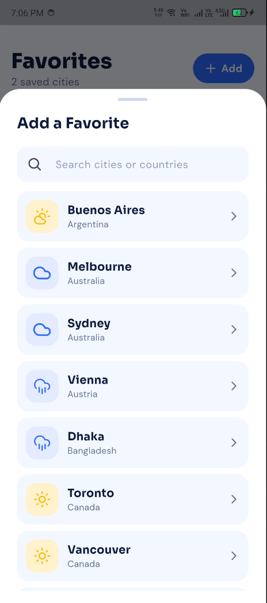

# Nimbus Weather ⛅

<p align="center">
  
</p>

<p align="center">
  <strong>A modern, full-stack weather intelligence application engineered with Flutter, Node.js, and Supabase PostgreSQL.</strong>
</p>

<p align="center">
  
  
  
  
  
  
  
</p>

---

## 🌟 Overview

**Nimbus Weather** is a production-grade, full-stack mobile application delivering real-time meteorological data, multi-day forecasts, and city exploration with an elegant, responsive interface. Designed with performance, clean separation of concerns, and recruiter-ready architecture in mind, Nimbus demonstrates end-to-end full-stack capabilities—from a reactive Flutter frontend to a custom Node.js/Express API layer backed by Supabase PostgreSQL and live weather aggregation.

---

## 📱 App Showcase

<table align="center">
  <tr>
    <td align="center" width="33%">
      <br />
      <strong>Explore & Regional Weather</strong><br />
      <em>Curated city feeds, dynamic condition highlights, and region-based discovery.</em>
    </td>
    <td align="center" width="33%">
      <br />
      <strong>Fast City Search</strong><br />
      <em>Real-time global search with instant weather preview chips and city taglines.</em>
    </td>
    <td align="center" width="33%">
      <br />
      <strong>Detailed Metrics & Forecast</strong><br />
      <em>Hourly charts, 5-day forecasts, UV index, wind speed, and key landmarks.</em>
    </td>
  </tr>
  <tr>
    <td align="center" width="33%">
      <br />
      <strong>Persistent Favorites</strong><br />
      <em>Saved cities dashboard with live weather telemetry and customized user notes.</em>
    </td>
    <td align="center" width="33%">
      <br />
      <strong>Interactive Note Taking</strong><br />
      <em>Seamless modal bottom sheets to attach personal notes to saved cities.</em>
    </td>
    <td align="center" width="33%">
      <br />
      <strong>User Profile & Settings</strong><br />
      <em>Account management, units & theme controls, and authenticated session state.</em>
    </td>
  </tr>
  <tr>
    <td align="center" colspan="3">
      <br />
      <strong>Profile Customization</strong><br />
      <em>Secure profile edits, form validation, and instant state synchronization.</em>
    </td>
  </tr>
</table>

---

## 🚀 Key Features

- **🌤️ Hyper-Local Weather & Forecasts**: Real-time temperature, condition mapping (WMO code translation), humidity, wind metrics, UV index, and 5-day daily forecasts.
- **🔍 Intelligent Exploration**: Filter world cities across regions (Europe, Asia, Americas, etc.) with landmark points of interest.
- **❤️ Cloud-Synchronized Favorites**: Save favorite destinations to Supabase with personalized user notes; changes reflect seamlessly across sessions.
- **🔐 Secure Authentication**: Complete JWT-based auth flow (sign up, sign in, auto-login with encrypted local token persistence via `SharedPreferences`).
- **✨ Fluid UI/UX**: Shimmer loading skeletons with `Skeletonizer`, clean typography using `Google Fonts (Poppins)`, and crisp iconography powered by `Phosphor Icons`.

---

## 🛠️ Architecture & Engineering Highlights

```
nimbus_weather_app/
├── app/                  # Mobile Client (Flutter 3.x + GetX)
│   ├── lib/
│   │   ├── constants/    # Design tokens, routes, colors & API configurations
│   │   ├── controllers/  # Reactive GetX business logic (Auth, City, Favorites, etc.)
│   │   ├── models/       # Strongly typed JSON serialization models
│   │   ├── views/        # Clean UI screens (Explore, Details, Favorites, Profile)
│   │   └── widgets/      # Reusable UI components & custom bottom sheets
│   └── screenshots/      # High-resolution production app captures
│
└── backend/              # Custom Microservice API (Node.js + Express)
    ├── db/               # PostgreSQL connection pooling with Supabase
    ├── middleware/       # JWT bearer token verification & error handlers
    ├── routes/           # REST endpoints for Auth, Cities, and Favorites
    ├── services/         # Open-Meteo aggregation & in-memory caching engine
    └── supabase_schema.sql # Relational database schema, indexes & seed data
```

### 1. Reactive State Management & Separation of Concerns (GetX)
- Employs a decoupled **MVC / Clean Architecture** separating pure presentation widgets from controller business logic.
- Utilizes GetX reactive observables (`Rx`, `Obx`) for minimal rebuild trees, snappy 60fps animations, and zero boilerplate.
- Centralized dependency injection and navigation management without BuildContext coupling.

### 2. High-Performance Node.js Weather Aggregator
- **In-Memory TTL Caching**: Implements a 15-minute in-memory cache layer (`Map`-based) in `weather_service.js` to drastically reduce third-party API rate limits and deliver sub-millisecond response times for frequent queries.
- **WMO Code Normalization**: Translates raw meteorological WMO codes from Open-Meteo into human-readable condition metadata and asset-ready icon mappings.

### 3. Scalable Relational Database (Supabase / PostgreSQL)
- Normalized relational schema supporting users, cities, landmarks (`city_places`), and user-specific favorites with notes.
- Optimized query performance through compound foreign keys and B-Tree indexes on `user_id` and `region`.
- Cascading deletes ensure referential integrity when users or cities are modified.

### 4. Robust Security & Session Lifecycle
- Password hashing utilizing industry-standard `bcryptjs` with salt rounds.
- Stateless authentication with signed JSON Web Tokens (`jsonwebtoken`) and automated authorization verification middleware.
- Client-side token storage and proactive session restoration on application boot.

---

## 💻 Tech Stack Summary

| Layer | Technologies |
|---|---|
| **Frontend Framework** | [Flutter](https://flutter.dev) (Dart 3.x) |
| **State Management** | [GetX](https://pub.dev/packages/get) |
| **UI Components & Styling** | [Phosphor Icons](https://pub.dev/packages/phosphoricons_flutter), [Skeletonizer](https://pub.dev/packages/skeletonizer), [Google Fonts](https://pub.dev/packages/google_fonts) |
| **Backend Runtime** | [Node.js](https://nodejs.org) & [Express.js](https://expressjs.com) |
| **Database & ORM** | [Supabase](https://supabase.com) / [PostgreSQL](https://www.postgresql.org) (`pg` driver) |
| **Authentication & Security** | JWT (JSON Web Tokens) & `bcryptjs` |
| **External Weather API** | [Open-Meteo](https://open-meteo.com) |

---

<p align="center">
  Crafted with care to demonstrate production-grade full-stack engineering, performance, and attention to detail.
</p>
