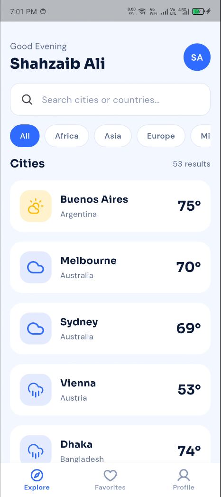
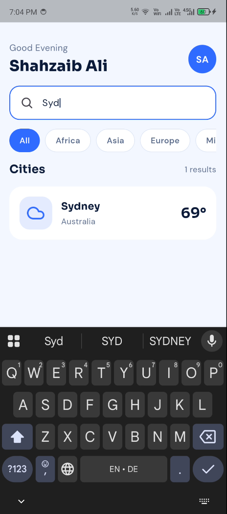
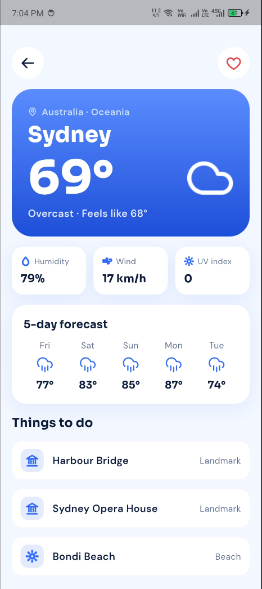
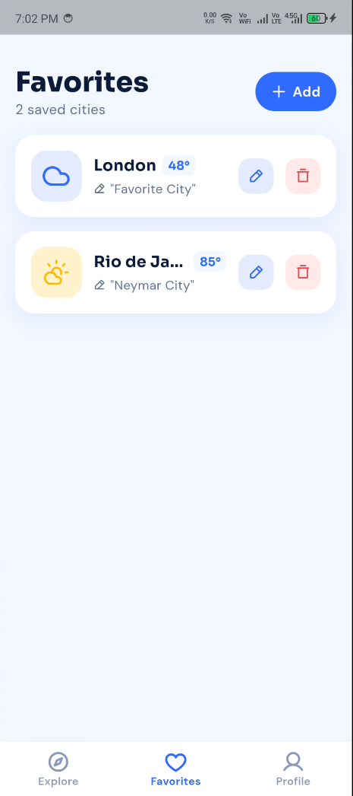
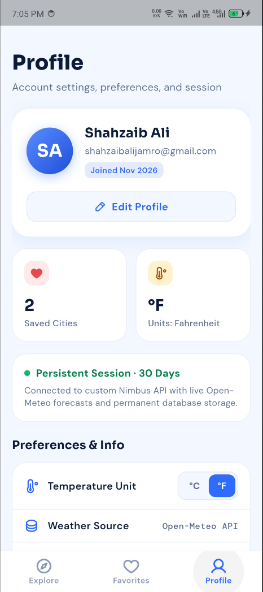

# Nimbus Weather

<p align="center">
  
</p>

<p align="center">
  <strong>A full-stack weather intelligence application built with Flutter, Node.js, Express, and Supabase PostgreSQL.</strong>
</p>

<p align="center">
  
  
  
  
  
  
  
</p>

---

## Overview

Nimbus Weather is a full-stack mobile application that provides real-time weather observations, multi-day forecasts, and global city discovery. 

The project demonstrates an end-to-end architecture pairing a reactive Flutter client with a custom Node.js and Express microservice. Meteorological data is gathered through Open-Meteo and routed through a persistent Supabase PostgreSQL database with server-side caching.

---

## Application Showcase

<table align="center">
  <tr>
    <td align="center" width="33%">
      <br />
      <strong>Explore & Regional Weather</strong><br />
      <sub>Categorized cities, condition indicators, and region-based filtering.</sub>
    </td>
    <td align="center" width="33%">
      <br />
      <strong>City Search</strong><br />
      <sub>Debounced search with quick-access temperature and weather previews.</sub>
    </td>
    <td align="center" width="33%">
      <br />
      <strong>Detailed Metrics & Forecast</strong><br />
      <sub>Hourly trends, 5-day forecasts, UV index, wind metrics, and local landmarks.</sub>
    </td>
  </tr>
  <tr>
    <td align="center" width="33%">
      <br />
      <strong>Persistent Favorites</strong><br />
      <sub>Saved locations synchronized to the cloud with user-attached notes.</sub>
    </td>
    <td align="center" width="33%">
      <br />
      <strong>Personal Notes Management</strong><br />
      <sub>Modal sheets allowing users to append and update custom notes per city.</sub>
    </td>
    <td align="center" width="33%">
      <br />
      <strong>User Profile & Account</strong><br />
      <sub>Authentication state, user preference options, and session overview.</sub>
    </td>
  </tr>
  <tr>
    <td align="center" colspan="3">
      <br />
      <strong>Profile Settings</strong><br />
      <sub>Inline user detail updates with validation and immediate client-side sync.</sub>
    </td>
  </tr>
</table>

---

## Features

- **Live Meteorological Tracking**: Real-time conditions including temperature, humidity, wind velocity, UV index, surface pressure, and 5-day daily forecasts.
- **Regional Discovery**: Filter and inspect metropolitan hubs grouped across Europe, Asia, the Americas, and other territories.
- **Synchronized Favorites**: Save cities with custom notes to a persistent Supabase backend, keeping state consistent across devices and app relaunches.
- **JWT Authentication**: Secure user registration, credential hashing, token generation, and persistent session recovery on startup.
- **Optimized UI State**: Responsive layouts built with GetX reactive observables, skeleton loaders for asynchronous requests, and consistent typography.

---

## Architecture & Engineering Highlights

```
nimbus_weather_app/
├── app/                  # Flutter Mobile Client
│   ├── lib/
│   │   ├── constants/    # Design tokens, theme keys, route definitions, API constants
│   │   ├── controllers/  # GetX controllers handling state, auth, and data fetching
│   │   ├── models/       # Serialization models for cities, weather, and users
│   │   ├── views/        # Page views (Explore, Details, Favorites, Profile)
│   │   └── widgets/      # Shared modular UI components
│   └── screenshots/      # Production application screenshots
│
└── backend/              # Node.js + Express API
    ├── db/               # PostgreSQL pool configuration with Supabase
    ├── middleware/       # JWT verification and request validation
    ├── routes/           # REST endpoints (/auth, /cities, /favorites)
    ├── services/         # Open-Meteo client and in-memory TTL cache
    └── supabase_schema.sql # Database DDL, relational constraints, and seed data
```

### Reactive State Management & Separation of Concerns
The client application adopts an MVC pattern powered by GetX. Controllers isolate business logic, API communication, and state updates from the view layer. By leveraging reactive observables (`Rx`, `Obx`), widgets only rebuild when their referenced data points change, minimizing unnecessary widget tree recalculations.

### Backend Caching & Condition Normalization
To prevent unnecessary external network calls and respect third-party rate limits, the Node.js backend implements an in-memory TTL cache (15-minute window) in `weather_service.js`. In addition, the service translates raw WMO meteorological codes from Open-Meteo into standardized condition schemas used by the client to render matching vector assets.

### Relational Database Design
Data persistence relies on PostgreSQL hosted on Supabase:
- Relational tables for users, cities, regional landmarks (`city_places`), and favorites.
- B-Tree indexes on high-frequency lookup columns (`favorites.user_id`, `cities.region`).
- Foreign key constraints with cascading deletes ensure referential integrity when users remove saved records.

### Authentication & Token Security
- Passwords are salted and hashed using `bcryptjs` prior to storage.
- Stateless authentication is enforced using signed JSON Web Tokens (`jsonwebtoken`) inspected via Express middleware.
- The mobile client securely persists tokens locally using `shared_preferences` and verifies validity on app initialization.

---

## Tech Stack Summary

| Component | Technology |
|---|---|
| Frontend | Flutter (Dart 3.x) |
| State Management | GetX |
| Backend | Node.js, Express.js |
| Database | PostgreSQL (Supabase) |
| Authentication | JSON Web Tokens (JWT), bcryptjs |
| Data Source | Open-Meteo API |
| UI Libraries | Skeletonizer, Google Fonts, Phosphor Icons |

---

<p align="center">
  Nimbus Weather — Full-Stack Portfolio Project
</p>
